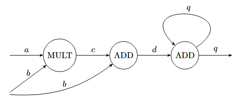

# LOI - A Research Tool for Emergent Computatin

Language Of Interaction (LOI) is a programming language and research tool for modeling, simulating, and analyzing complex systems. It is designed to explore how behaviors emerge from interactions between simple components, and to compare how systems with different structure may produce similar behaviors.

LOI is inspired by Hardware Description Languages like Verilog, where circuits of logic gates and other digital components are described in a programming language-like syntax. LOI, however, generalizes this concept from boolean wires and logic, to arbitrary types, and allows the user to define arbitrary relations (gates) in a functional programming-like syntax.

# Why LOI?

Many systems, especially complex systems, can be understood as networks of interacting components. Digital circuits, neurl networks, cellular atomata, quantum circuits, physical systems, and other dynamical systems differ in their physical interpretations, but can share mathematical structures.

LOI was cretaed to provide a common language and framework for studying these systems and the behavior that emerges from their internal interaction.

The project emphasizes:

- **A unified mathematical model.** Describe systems using entites, relations, and networks.
- **Emergent behavior.** Investigate how potentially simple local interactions produce complex global behavior
- **Experimentation.** Construct models, run simulations, and analyze behavior of your systems.

LOI is intended primarily as a research tool, not as a replacement for established HDLs or general-purpose programming languages.

# What can you do with LOI?

LOI provides a toolchain for modeling and investigating network-based dynamical systems.

Depending on the model and available analysis tools, applications include:

- **Digital systems:** Logic networks, sequential circuits, state machines, small architectures
- **Cellular atomata:** Any dimensional, graph-based atomata (arbitrary topology), probabilistic, asynchronous, any state 
- **Dynamical networks:** Systems whose behavior depends on interactions, feedbacks, delays, and internal state.
- **Neural and neuromorphic models:** Spiking Neural Networks, neuron and synapse models, population models.
- **Stochastic systems:** Markov chains, random walks
- **Reversible logic and computation**
- **Signal processing models**

The underlying framework is intended to support comparisons across different kinds of systems. More specialized physical models, including analog and quantum systems, are planned areas for further development

# Features

- A domain-specific language for describing networks and relations.
- A compiler to translate source programs into an executable representation.
- A simulator to run compiled models.
- Simulation input and output file formats for interacting with models.
- A command-line interface for compiling and running models.

See the project documentation for the exact feature set and current limitations.

# Installation

## Prerequisites

- A supported Rust toolchain.
- Cargo, the Rust package manager.

Install Rust and Cargo using rustup if they are not already available.

## Build from source

Clone the repository and build the project:

```bash
git clone <repository-url>
cd <repository-directory>
cargo build --release
```

Run the test suite to verify the build:

```bash
cargo test
```

The resulting executable is available under target/release/. The exact executable name and any additional runtime requirements should be verified for your platform.

For development, run LOI directly through Cargo:

```bash
cargo run -- --help
```

If you want to invoke LOI globally, install the local package using Cargo:

```bash
cargo install --path .
```

Confirm the supported installation and executable commands against the current repository configuration.

# What does a LOI program look like?

A LOI program describes a system in terms of a network composed of entities and relations.

- **Entities** hold values like wires in a circuit.
- **Relations** are functions that map the values on input entites to values on an output entitiy after a time delay.
- **Networks** organize entites and relations, describing how they are "connected" together.

Following is a simple example of a network:

```loi
rel_t ADD(a: Int, b: Int) -> Int = a + b;

rel_t MULT(a: Int, b: Int) -> Int = a * b;

net EXAMPLE {
      input a: Int;
      input b: Int;

      output q: Int;

      MULT(a, b) := c;

      ADD(b, c) := d;

      ADD(q, d) := q;
}
```

In this program, ADD and MULT are relation types instantiated in the EXAMPLE network. In this network, a, b, c, d, and q are entites which hold an integer value. a and b feed into the MULT relation. This output along with b feed into the first ADD relation. This output feeds into the second ADD relation which also takes its own output as an input.



Along with a network, in order to run a simulation one must supply inputs to the relative entities. This is done thorugh .txt files like the following example:

```
step entity value

1 a 20
1 b 30

5 a -20
```

See the language reference and example programs for complete, executable models.

# Running a program

LOI supports compilation and simulation throuth its command-line interface.

First, inspect the available commands:

```bash
cargo run -- help
```

For a source file, identify the network to simulate and prepare the input data file. Invoke the simulation with:

```bash
cargo run -- simulate-full <relative path to program>.loi <input file>.txt <output file>.txt <sim steps> <net to simulate>
```

# Learning the language

1. ***README*** for a brief introduction

2. **Language reference** in /docs/language to learn language syntax and abilities

3. **Semantic reference** in /docs/semantics to learn the broader meaning and rules of the language

3. **Examples** in /examples for several examples of valid networks.

4. **CLI*** in /docs/cli for details on how to run your program.

# Project status

Current version: 1.~

LOI v1.~ represents the completion of the initial core toolchain. Moving forward the focus will be:

- Adding analysis tools to understand the dynamics, emergent behavior, and shared features of networks
- Expanding language to make modeling of systems simpler and more straightforward.

LOI is an active and growing research-oriented project.

# Contributing

Contributions, bug reports, and research ideas are welcome.

When reporting an issue, include a minimal LOI program, the command used to run it, the observed behavior, and the expected behavior where applicable.

For proposed features, it is helpful to describe the underlying research question or modeling need as well as the implementation.

# AI Development

This project, its vision, and architecture were developed by me. AI tools were used as an advisory resource in debugging and discussing implementation details, and in drafting simple methods and function. ~15% of the code was written by ChatGPT under strict supervision, the rest was written by me.

# License

LOI is distributed under the Apache License 2.0. See LICENSE for details.
