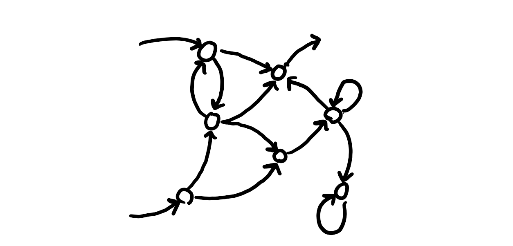

# Semantics

This document serves as a reference and guide for the semantics, or meaning of the language and how to interpret and think abut LOI programs.

For a reference on LOI syntax, see /docs/language. 

# Meaning of a Program

# Entities

At a high level, every LOI program defines a system of connected objects, known as entities. Each entity holds some value. Could be a boolean, representing whether current is flowing through a wire or not, or a number representing the velocity of an object, or a state representing the state of a component in a system. The purpose of LOI is to represent many kinds of systems generally.

# Relations

Within most systems, certain entities influence the values of others. For example, a switch turned on causes a lightbulb to be on or off, or a cell in a cellular automata helps determine the next value of its neighbor.

In LOI, these relationships are represented through relations. Relations determine the value on an entity at the next timestep based on the values of some set of entities now. The state of our lightswitch now determines if the lightbulb will be on or off in a few nanoseconds.

Deterministic relations are mathematical functions. Nondeterministic relations sample from a probability distribution. For example, a deterministic relation rule could be:

$e_1[t+1] = e_2[t] + e_4[t]$

In this case, the next value on entity 1 is determined by summing the values on entities 2 and 4.

For convenience, we will often refer to the value on an entity that is used as an input to the function on a relation as an input to the relation, and the value on an entity determined by the function as an output of the relation.

# Networks and Graphical representations

A network is a collection of entities and relations. A network defines a system whose behavior emerges from the combined behavior of its relations and the values stored in its entities.

It is often useful to reason about and mentally picture networks spatially. This is where directed graphs come in. Consider a possible graphical representation of our function $e_1[t+1] = e_2[t] + e_4[t]$:

We are choosing to represent entities as arrows, and relations as vertices. This comes from the convention in digital circuits as representing logic gates (a special case of a relation) as uniquely shaped vertices and the wires connecting them as lines. We add arrows to make it clear which vertex is "driving" or assigning the values on an entity and which vertex is "being driven" or taking that enties value in a function.

One potential confusion with this convention is that any vertex may have multiple outgoing arrows. In LOI, each of those outgoing arrows represent the same entity, just like all wires coming out of a logic gate (under proper assumptions) are holding the same value.

Networks can get much more complicated than our previous example.

# Feedback and memory

Relations do not store state; they determine outputs from their inputs. Entities, however, hold values across simulation timesteps. By feeding an entity's current value back into the relation that determines its next value, a network can preserve state over time.

For example, the following rule preserves an enties value across simulation steps:

$e_1[t+1] = e_1[t]$

# Inputs and Outputs

Input entities receive values from outside the network, while output entities expose values for an outside source to read. The rest of the network determines how input values influence its internal state and outputs over time.

# Time evolution

Entity values evolve in discrete timesteps. At each timestep, relations use entity values to determine the next values of their outputs, and the network advances to the next state. Discrete steps were chosen based on the nature of computers executing in discrete steps. Continuous time systems can be approximated by letting the timesteps be small.

See /docs/architecture for details on how networks are simulated internally.

See /examples for some sample LOI programs.